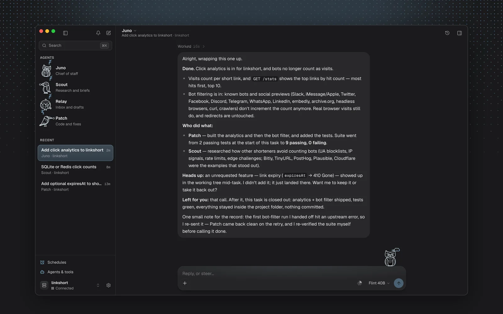
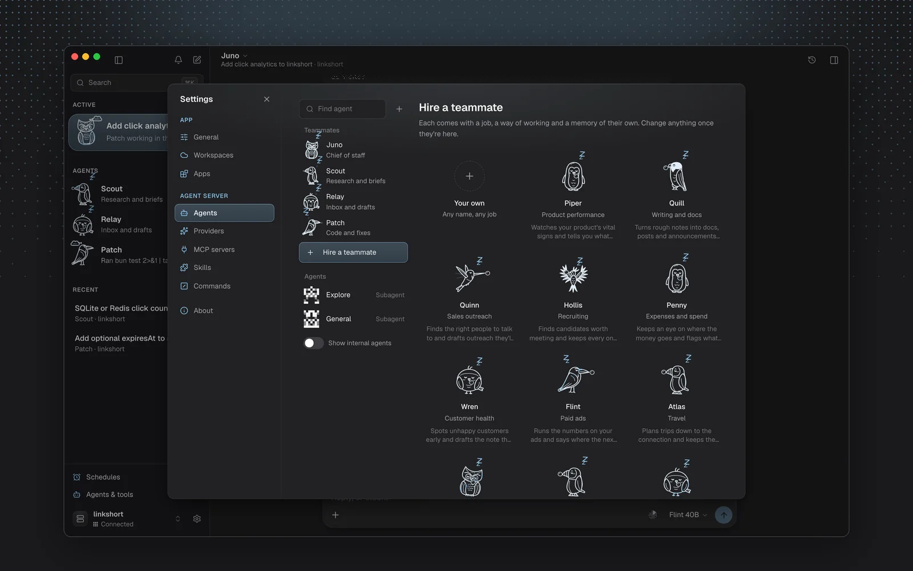
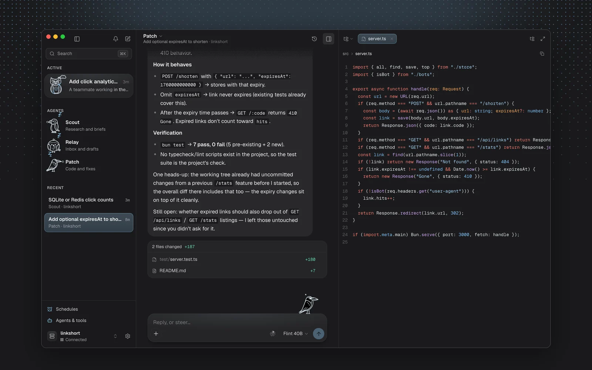
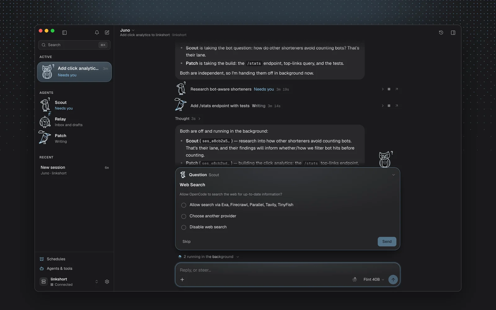
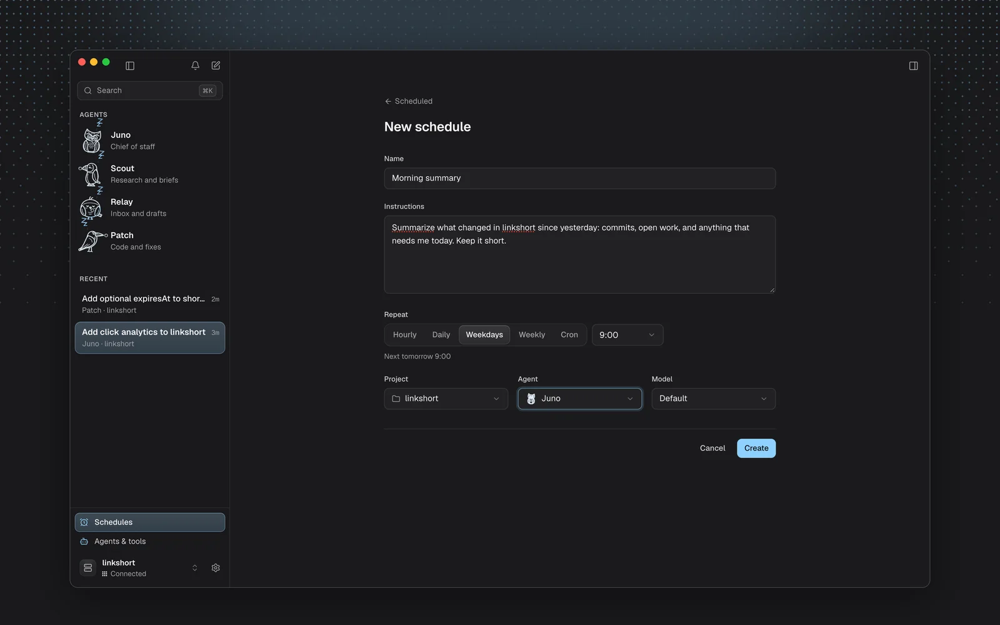
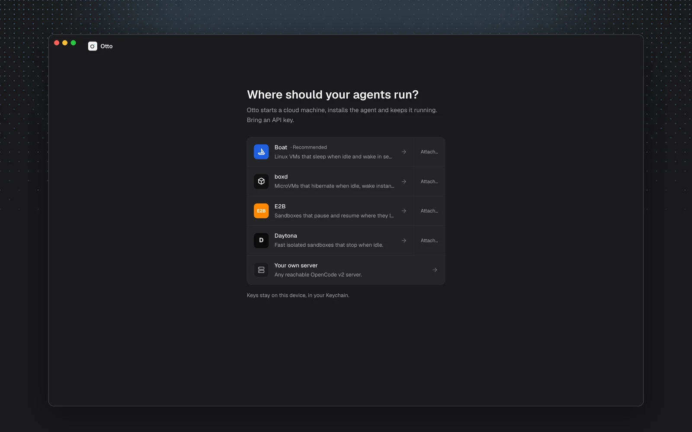
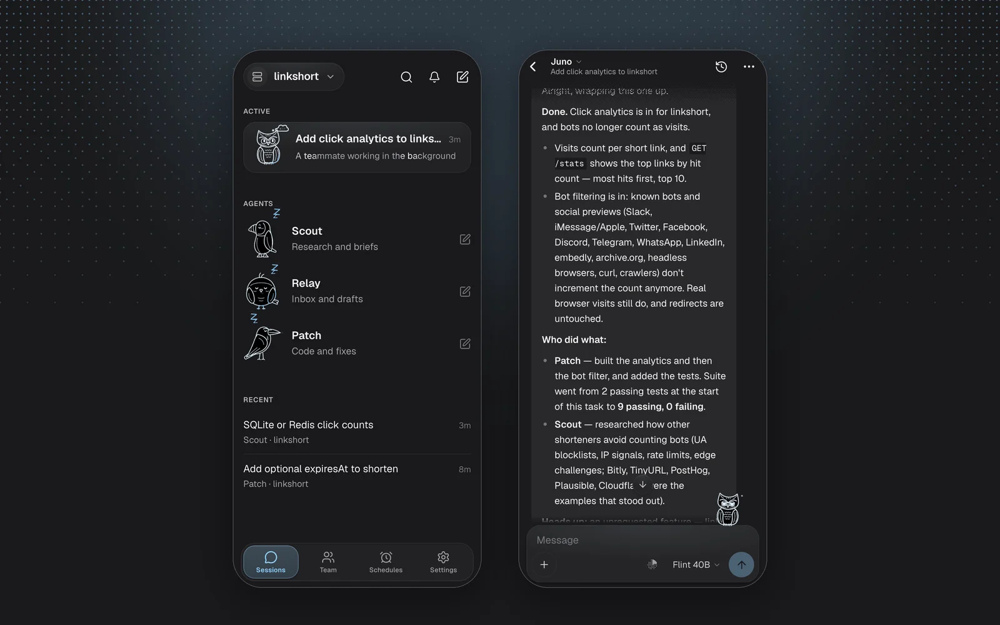

<p align="center">
  
</p>

<h1 align="center">Otto</h1>

<p align="center">Your AI team. Always on.</p>

<p align="center"><a href="https://jaygupta.dev/otto">Website</a> · <a href="https://github.com/jaygupta17/otto/releases/latest">Download</a> · <a href="https://jaygupta.dev/otto/releases">Changelog</a></p>

<p align="center">
  
</p>

---

Otto is a desktop and mobile app for [OpenCode v2](https://opencode.ai) that gives you a team of AI agents. Each teammate has a name, a face, a role and its own permissions. They run on a cloud machine or your own server, keep working when your laptop sleeps, and you can check in from your phone.

It runs on macOS, Windows, Linux, iOS and Android, built with [Tauri 2](https://tauri.app).

## What you can do

- **Start with a team.** Juno, your chief of staff, splits work and hands it to Scout (research), Relay (inbox and drafts) and Patch (code). Hire more from the gallery, or make your own with a personality, model and instructions.
- **Hand work off and keep going.** Teammates take tasks in the background and report back. Steer a run while it works, or queue the next message.
- **Answer only what needs you.** Approvals and questions dock above the composer and show up as notifications, on whichever device you pick up first.
- **Decide what each teammate may do.** Allow, ask or block per tool, per skill, per MCP server and per command or path pattern.
- **Connect your apps.** Gmail, Calendar, Slack, Notion, GitHub and more through [Composio](https://composio.dev), with per-app permissions.
- **Let them remember you.** Teammates keep notes about you and your work, and you can read and edit them.
- **Schedule work.** A morning summary on weekdays, dependency updates every night. Schedules are cron jobs on the agent machine, so they run with Otto closed.
- **See what they made.** Agents show a page, a screenshot, a report or a URL in a panel beside the chat — images fit the space, pages are framed, files read like files — instead of describing them. The same panel holds terminals that run on the agent machine and, on Boat, the agent's own screen, which you can take control of.
- **Share into Otto.** Attach files to a message, or share from any Android app.



<table>
  <tr>
    <td width="50%"><br /><sub>Hire teammates for the work you have.</sub></td>
    <td width="50%"><br /><sub>Read the code next to the conversation.</sub></td>
  </tr>
  <tr>
    <td width="50%"><br /><sub>Questions and approvals wait above the composer.</sub></td>
    <td width="50%"><br /><sub>Work that runs on its own.</sub></td>
  </tr>
  <tr>
    <td width="50%"><br /><sub>Pick a cloud and paste a key, or bring your own server.</sub></td>
    <td width="50%"><br /><sub>Check in from your phone.</sub></td>
  </tr>
</table>

## How it works

```
 Otto (Tauri app)                       Cloud machine (Boat sandbox or your server)
 ─────────────────                      ───────────────────────────────────────────
 React UI                               systemd: otto-opencode.service
   │  REST + Server-Sent Events  ───►   opencode serve  (OpenCode v2 API)
   │  over HTTPS, password-protected      ├─ sessions, agents, tools, MCP
 Rust side                                └─ ~/.otto  (scheduled tasks, cron)
   ├─ HTTP client (no CORS, streaming)
   ├─ OS keychain for secrets
   └─ notifications
```

1. **Setup.** Choose [Boat](https://boat.dev), [boxd](https://boxd.sh), [E2B](https://e2b.dev) or [Daytona](https://daytona.io) and paste a key. Otto uses the provider's API to create a machine, install OpenCode v2, write a systemd unit with a random password, and expose the port on the provider's HTTPS proxy. On a desktop you can also run OpenCode on the same computer, or connect any OpenCode v2 server you already run.
2. **Connect.** The app talks to OpenCode's own API: REST for actions and one Server-Sent Events stream for live updates. If the machine is asleep, Otto wakes it and repairs the service when needed.
3. **Storage.**
   - **Your device:** app choices (theme, last model per workspace).
   - **The OS keychain:** secrets (API keys, server passwords).
   - **The agent machine:** everything shared (sessions, agents, config, schedules), so every device sees the same state.

## Download

On macOS, one command installs the latest version into Applications ([script](scripts/install.sh)):

```sh
curl -fsSL https://jaygupta.dev/otto/install.sh | sh
```

Everything else is on [Releases](https://github.com/jaygupta17/otto/releases/latest).

| Platform | File |
| --- | --- |
| macOS (Apple silicon) | `Otto_<version>_aarch64.dmg` |
| macOS (Intel) | `Otto_<version>_x64.dmg` |
| Windows | `Otto_<version>_x64-setup.exe` or `.msi` |
| Linux | `.AppImage`, `.deb` or `.rpm` |
| Android | `Otto_<version>_android.apk` |

The builds aren't code-signed yet, so your OS will warn you the first time:

- **macOS:** the install command above avoids this. With the `.dmg`, Otto isn't notarized yet, so the first launch is blocked. Move it to Applications and open it once, then go to **System Settings → Privacy & Security** and click **Open Anyway**. If macOS says Otto "is damaged" instead, run `xattr -dr com.apple.quarantine /Applications/Otto.app`.
- **Windows:** on the SmartScreen prompt, choose **More info**, then **Run anyway**.
- **Android:** open the APK from your phone's browser or Files app and allow **Install unknown apps** for it when asked.
- **iOS:** Apple doesn't allow installing apps from a download. Build it yourself with Xcode (see [Mobile](#mobile)).

## Getting started

To build from source.

### Prerequisites

- [Bun](https://bun.sh) 1.3+
- [Rust](https://rustup.rs) (stable) and the [Tauri prerequisites](https://tauri.app/start/prerequisites/) for your OS
- For mobile builds: Xcode (iOS) or Android Studio with the NDK (Android)

### Run the desktop app

```bash
bun install
bun run app:dev
```

### Try it without a cloud account

Run a local OpenCode v2 server with an isolated config, so nothing touches your own `~/.config/opencode`:

```bash
bun run oc:local
```

Then in Otto choose **Your own server**, enter `http://127.0.0.1:4917`, and use the password printed in `.dev/password`. Free models work without any provider key.

### Mobile

```bash
bun run tauri ios init       # once
bun run ios:dev
bun run tauri android init   # once
bun run android:dev
```

### Build

```bash
bun run app:build
```

### Release

```bash
bun run release            # next patch version; or minor, major, x.y.z
```

See [RELEASING.md](RELEASING.md) for the full flow. The [Release workflow](.github/workflows/release.yml) builds macOS, Windows, Linux and Android into a draft release. To sign the Android APK with a stable key, set the repository secrets `ANDROID_KEYSTORE_BASE64`, `ANDROID_KEY_ALIAS` and `ANDROID_KEY_PASSWORD`; without them each build is signed with a throwaway key.

## Project layout

```
src/
  components/         UI: shell, chat, panel (dock, artifacts, terminal, screen),
                      settings, schedules, onboarding, mobile, share
  lib/opencode/       OpenCode v2 client, event stream, timeline projection, config files
  lib/providers/      Boat, boxd, E2B, Daytona, this computer, and the setup/repair flow
  lib/flock/          The teammates' birds
  lib/teammates.ts    Teammates: roles, personalities, the starter team and hire gallery
  lib/memory.ts       What teammates remember about you
  lib/composio.ts     Connected apps
  lib/schedules.ts    Scheduled tasks (cron + runner script on the agent machine)
  lib/artifacts.ts    What an agent's `present` call is, and how it may be shown
  lib/permissions.ts  Agent permission rules editor model
  state/              Zustand stores (connection, chat, workspaces, teammates, ui, ...)
src-tauri/            Rust side: plugins, keychain, local server, app config, icons
scripts/              Development and release helpers
docs/                 Notes for agents, such as how schedules work
DESIGN.md             Design system: tokens, type, color roles, motion
```

## Security

- Sandbox API keys and server passwords are stored in the OS keychain on macOS and Windows, and in the app's private storage elsewhere. They are never logged.
- Each workspace gets its own random server password. The OpenCode server is only reachable through the provider's token-gated HTTPS URL.
- App connections go through Composio with your own key. Each app's actions follow the same allow, ask or block rules.
- Scheduled tasks keep their credentials in `~/.otto/server.env` on the agent machine, readable only by the agent user.

Found a vulnerability? Please open a private security advisory on GitHub instead of an issue.

## Roadmap

- Diff review and one-click commits
- Push notifications for mobile

## Contributing

See [CONTRIBUTING.md](CONTRIBUTING.md).

## License

[MIT](LICENSE). Parts of the permission editor are adapted from [OpenChamber](https://github.com/openchamber/openchamber) (MIT); see [THIRD_PARTY_NOTICES.md](THIRD_PARTY_NOTICES.md).
