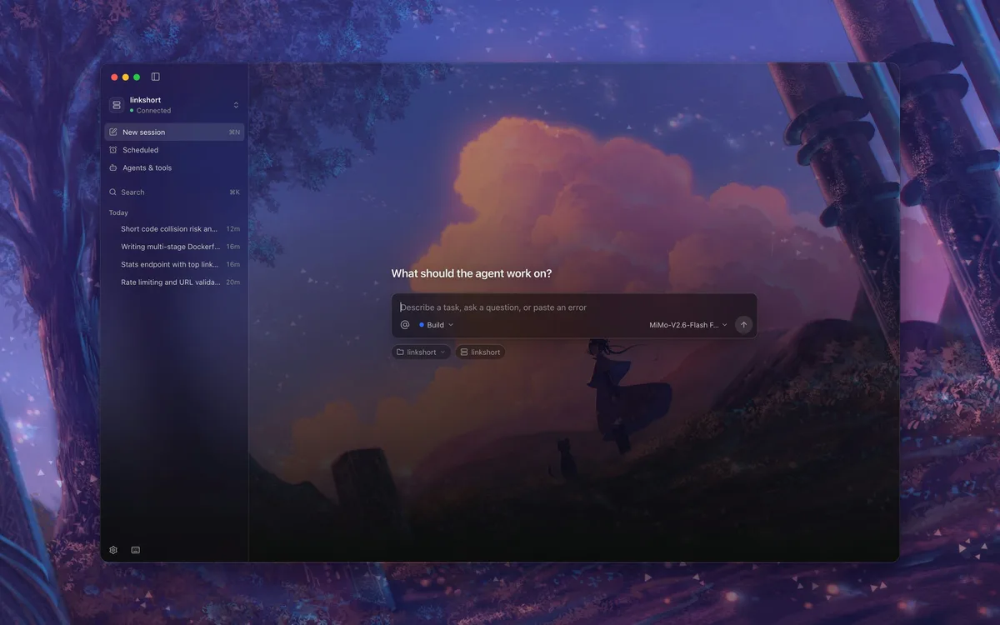
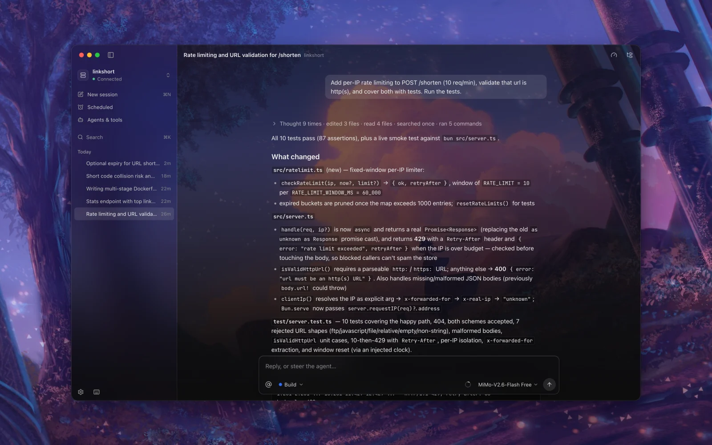
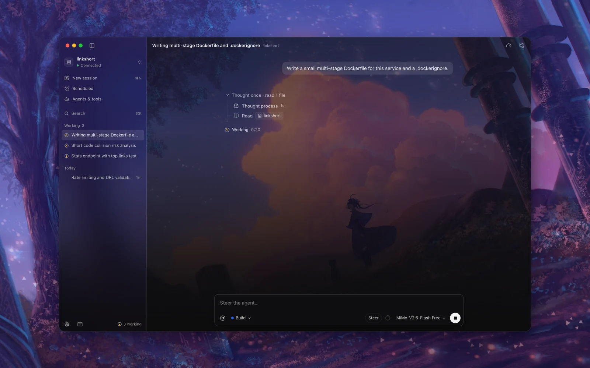
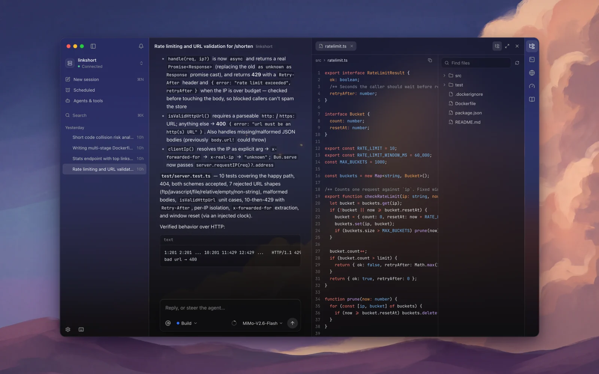
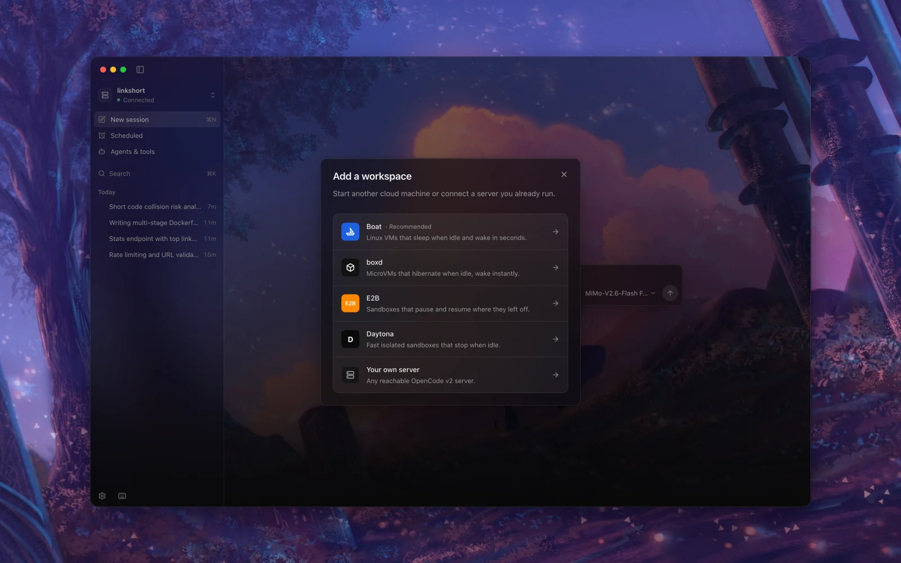
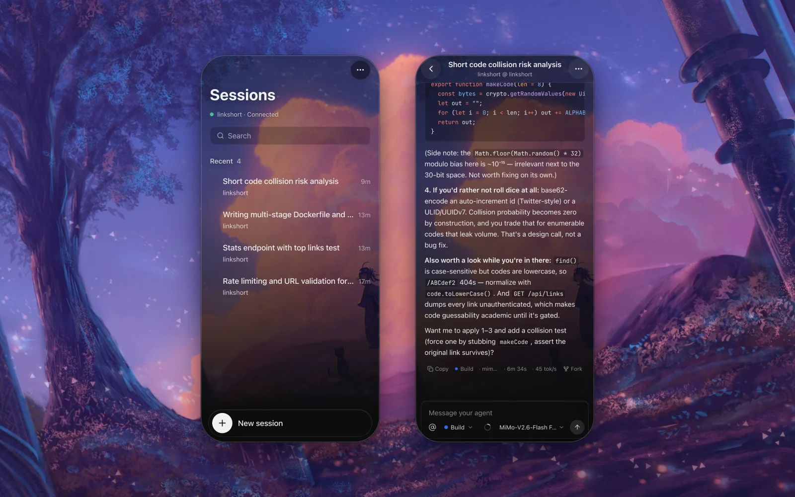

<p align="center">
  
</p>

<h1 align="center">Otto</h1>

<p align="center">Run coding agents on a cloud machine and steer them from your laptop or phone.</p>

<p align="center">
  
</p>

---

Otto is a desktop and mobile app for [OpenCode v2](https://opencode.ai). Paste a sandbox API key and Otto starts a Linux machine, installs OpenCode, keeps it running as a service and connects to it over HTTPS. Your agents keep working when your laptop sleeps, and you can check in from your phone.

It runs on macOS, Windows, Linux, iOS and Android, built with [Tauri 2](https://tauri.app).

## What you can do

- **Start a workspace in one step.** Choose [Boat](https://boat.dev), [boxd](https://boxd.sh), [E2B](https://e2b.dev) or [Daytona](https://daytona.io), paste a key, and Otto sets up the machine. Or connect any OpenCode v2 server you already run.
- **Work with agents in a live conversation.** Replies stream as they are written, and every file read, edit and command the agent runs is listed step by step. Stop or steer a run at any time.
- **Approve risky steps.** When an agent asks for permission or has a question, it shows up inline and in a system notification.
- **Manage agents and their permissions.** Create agents, set their model and instructions, and decide per tool, per skill and per MCP server what each agent may do: allow, ask or deny, with path and command patterns.
- **Add tools.** Manage MCP servers, skills and slash commands from the app.
- **Schedule work.** Have an agent run your tests every night or summarize changes every morning. Schedules run on the agent machine, so they fire even when Otto is closed.
- **Browse files.** Open the project tree and read files with syntax highlighting.



<table>
  <tr>
    <td width="50%"><br /><sub>Several agents at once, each in its own session.</sub></td>
    <td width="50%"><br /><sub>Read the code the agent wrote, next to the conversation.</sub></td>
  </tr>
  <tr>
    <td width="50%"><br /><sub>Pick a cloud, paste a key.</sub></td>
    <td width="50%"><br /><sub>Check in from your phone.</sub></td>
  </tr>
</table>

## How it works

```
 Otto (Tauri app)                       Cloud machine (Boat sandbox or your server)
 ─────────────────                      ───────────────────────────────────────────
 React UI                               systemd: otto-opencode.service
   │  REST + Server-Sent Events  ───►   opencode serve  (OpenCode v2 API)
   │  over HTTPS, password-protected      ├─ sessions, agents, tools, MCP
 Rust side                                └─ ~/.otto  (scheduled tasks, cron)
   ├─ HTTP client (no CORS, streaming)
   ├─ OS keychain for secrets
   └─ notifications
```

1. **Setup.** Otto uses the sandbox provider's API to create a machine, install OpenCode v2, write a systemd unit with a random password, and expose the port on the provider's HTTPS proxy.
2. **Connect.** The app talks to OpenCode's own API: REST for actions and one Server-Sent Events stream for live updates. If the machine is asleep, Otto wakes it and repairs the service when needed.
3. **Storage.**
   - **Your device:** app choices (theme, last model per workspace).
   - **The OS keychain:** secrets (API keys, server passwords).
   - **The agent machine:** everything shared (sessions, agents, config, schedules), so every device sees the same state.

## Getting started

### Prerequisites

- [Bun](https://bun.sh) 1.3+
- [Rust](https://rustup.rs) (stable) and the [Tauri prerequisites](https://tauri.app/start/prerequisites/) for your OS
- For mobile builds: Xcode (iOS) or Android Studio with the NDK (Android)

### Run the desktop app

```bash
bun install
bun run app:dev
```

### Try it without a cloud account

Run a local OpenCode v2 server with an isolated config, so nothing touches your own `~/.config/opencode`:

```bash
bun run oc:local
```

Then in Otto choose **Your own server**, enter `http://127.0.0.1:4917`, and use the password printed in `.dev/password`. Free models work without any provider key.

### Mobile

```bash
bun run tauri ios init       # once
bun run ios:dev
bun run tauri android init   # once
bun run android:dev
```

### Build

```bash
bun run app:build
```

## Project layout

```
src/
  components/      UI: shell, chat, settings, schedules, onboarding, mobile
  lib/opencode/    OpenCode v2 client, event stream, timeline projection, config files
  lib/providers/   Sandbox providers (Boat) and the setup/repair flow
  lib/schedules.ts Scheduled tasks (cron + runner script on the agent machine)
  lib/permissions.ts  Agent permission rules editor model
  state/           Zustand stores (connection, chat, workspaces, extensions, ui)
src-tauri/         Rust side: plugins, keychain commands, app config, icons
scripts/           Local development helpers
DESIGN.md          Design system: tokens, type, color roles, motion
```

## Security

- Sandbox API keys and server passwords are stored in the OS keychain on macOS and Windows, and in the app's private storage elsewhere. They are never logged.
- Each workspace gets its own random server password. The OpenCode server is only reachable through the provider's token-gated HTTPS URL.
- Scheduled tasks keep their credentials in `~/.otto/server.env` on the agent machine, readable only by the agent user.

Found a vulnerability? Please open a private security advisory on GitHub instead of an issue.

## Roadmap

- Terminal (PTY) panel
- Diff review and one-click commits
- Push notifications for mobile

## Contributing

See [CONTRIBUTING.md](CONTRIBUTING.md).

## License

[MIT](LICENSE). Parts of the permission editor are adapted from [OpenChamber](https://github.com/openchamber/openchamber) (MIT); see [THIRD_PARTY_NOTICES.md](THIRD_PARTY_NOTICES.md).
